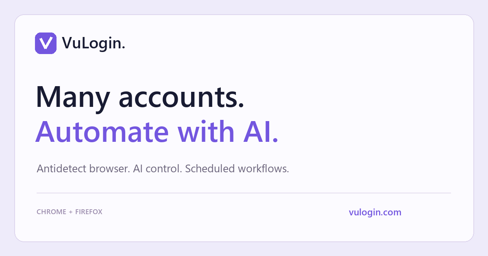
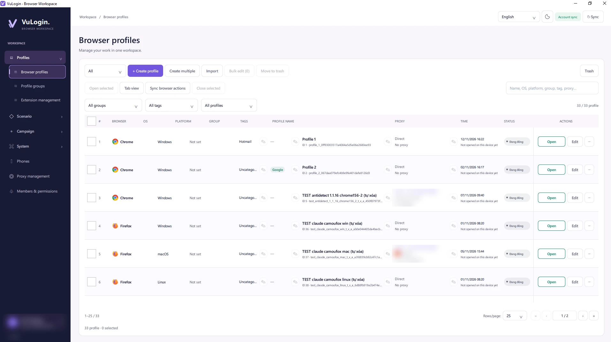
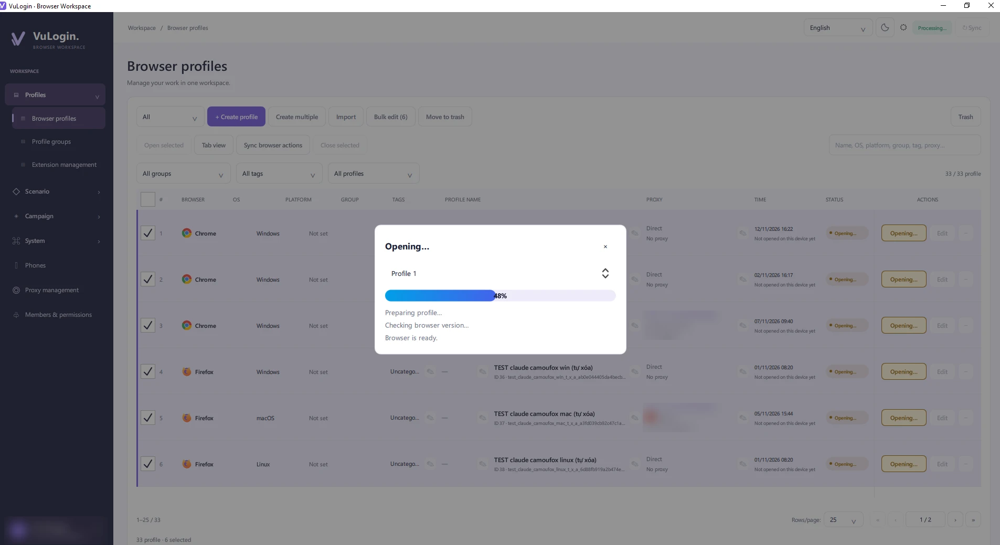
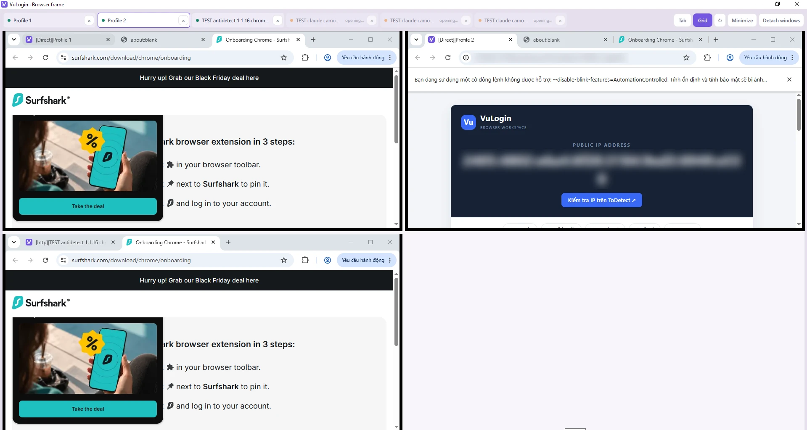
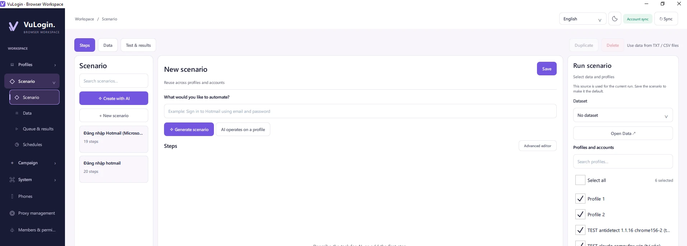
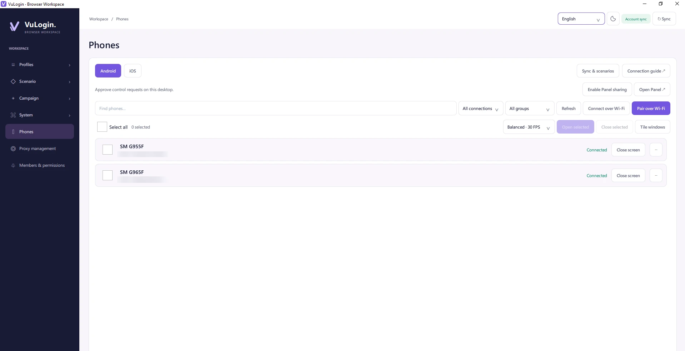
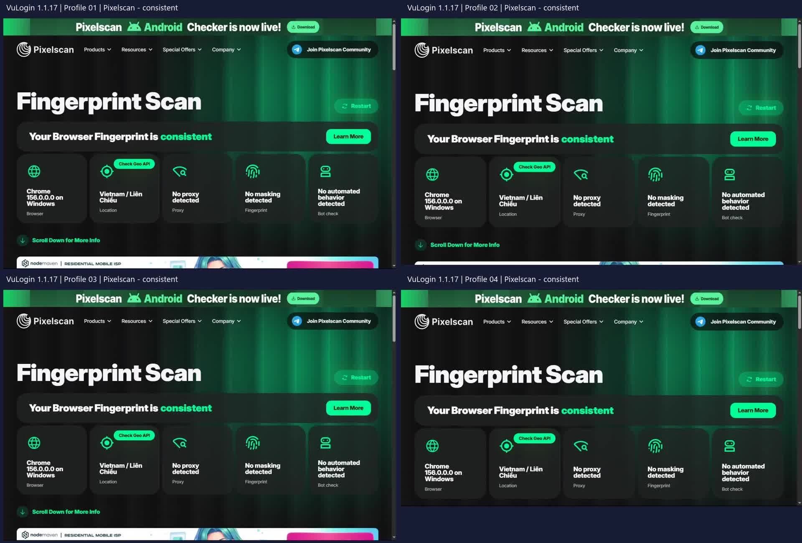

<div align="center">



# VuLogin

**Multi-Account Antidetect Browser & AI Automation**

Run multiple accounts in separate browser profiles, let AI handle browser tasks, schedule scenarios and launch campaigns with a fresh temporary profile each run.

### 🆓 Free forever — unlimited profiles, no time limit on the Free plan

[🌐 Website](https://vulogin.com) · [⬇️ Download](https://vulogin.com/download/) · [📖 Docs](https://vulogin.com/docs/) · [🔌 API](https://vulogin.com/api/) · [💲 Plans](https://vulogin.com/plans/) · [🖥️ Panel](https://panel.vulogin.com)

[🇻🇳 Tiếng Việt](README.vi.md) · [💬 Discord](https://discord.gg/QprX6zekYf) · [✈️ Telegram](https://t.me/vulogin)

</div>

---

> **About this repository**
> This repository is the public introduction and user guide for VuLogin. It contains no source code. The software itself, official downloads, documentation and account management live at **[vulogin.com](https://vulogin.com)**.

## Table of contents

- [What is VuLogin?](#what-is-vulogin)
- [Key features](#key-features)
- [Screenshots](#screenshots)
- [Quick start](#quick-start)
- [Usage guides](#usage-guides)
  - [1. Create a browser profile](#1-create-a-browser-profile)
  - [2. Set identity and proxy](#2-set-identity-and-proxy)
  - [3. AI browser control](#3-ai-browser-control)
  - [4. Scenarios, schedules and campaigns](#4-scenarios-schedules-and-campaigns)
  - [5. Connect Android phones](#5-connect-android-phones)
  - [6. Local API](#6-local-api)
- [Plans & pricing](#plans--pricing)
- [FAQ](#faq)
- [Community & support](#community--support)
- [Responsible use](#responsible-use)

## What is VuLogin?

VuLogin is a desktop antidetect browser workspace. It manages separate browser profiles, each with its own login session, cookies, storage and configurable browser identity, and combines them with proxies, team access and automation in one place.

It is built for people who work with several authorized accounts across **social media, e-commerce, advertising and other web platforms**, and want less manual, repetitive work.

- 🖥️ **Platform:** Windows 64-bit (EXE installer). A macOS release is coming later.
- 🌍 **Engines:** Chrome and Firefox profiles.
- 🆓 **Free forever** — the Free plan costs $0 with **unlimited browser profiles** and no time limit on usage. Upgrade only when you need more devices, sessions, workers or team members. See [Plans & pricing](#plans--pricing).

## Key features

| | Feature | Description |
|---|---|---|
| 👥 | **Multiple accounts, multiple platforms** | Each saved profile keeps its own login session, cookies and browser storage, so accounts stay separate. |
| 🛡️ | **Browser identity & privacy** | Give profiles separate browser identities and configure language, timezone and proxy to reduce fingerprint-based account linking. |
| 🤖 | **AI browser control** | Describe a task in everyday language. AI observes the selected tab and can navigate, click and enter data on the real profile while you watch and stop it any time. |
| 🎬 | **Visual scenarios** | Record browser actions, edit steps in the visual canvas, map datasets to profiles and save workflows for repeat runs. |
| ⏰ | **Scheduled automation** | Schedule a saved scenario on selected profiles; results appear in the queue. |
| 🔁 | **Fresh-profile campaigns** | Run a scenario in batches of temporary profiles. Each browser gets a fresh identity and is cleaned up after the run. Configure concurrency, run count and pauses. |
| 🌐 | **Proxy management** | Check connections, organize a proxy library and assign proxies to profiles. Campaigns can rotate selected proxies. |
| 🧑‍🤝‍🧑 | **Team workspace** | Group profiles by brand, client or platform and assign member permissions. |
| 🔌 | **Local API** | List, open and close profiles, run scenarios and inspect jobs from your own scripts (Python, Playwright, Selenium, REST/JSON). |
| 📱 | **Android phones** | Add phones by USB or Wi-Fi and open their screens inside VuLogin for Windows. |
| ☁️ | **Optional Cloud Backup** | Back up session data per profile when you need it. |

## Screenshots

Screens from the VuLogin desktop app (English interface).

### Browser profiles



*Create, group, tag and open Chrome and Firefox profiles from one workspace; each profile can use its own proxy.*

### Open many profiles at once



*Select several profiles and open them together with a live progress indicator.*

### Browser grid mode



*Several real browser windows tiled in VuLogin's grid view (test data).*

### Automation scenarios



*Describe a task for AI or build steps manually, then run the scenario on selected profiles with a dataset.*

### Android phones



*Connect Android phones over USB or Wi-Fi, open their screens and tile the windows.*

### Pixelscan: four profiles consistent



*Captured Nov 1, 2026 in VuLogin 1.1.17 over a direct connection. Results apply to this test configuration only and are not a guarantee for every website.*

## Quick start

1. **Open your account** at [panel.vulogin.com](https://panel.vulogin.com), then sign in or sign up.
2. **Download the app** from [vulogin.com/download](https://vulogin.com/download/) and run the Windows EXE installer.
3. **Sign in** to the desktop app with your VuLogin account and install the browser runtime it asks for.
4. **Create a profile** (Chrome or Firefox), set identity and proxy, then open it and visit the sites you are authorized to use.
5. **Automate**: let AI act, save the result as a scenario, then schedule it or run it as a campaign.

Full guide: [Getting started](https://vulogin.com/docs/getting-started/)

## Usage guides

### 1. Create a browser profile

In **Browser profiles**, choose **Chrome** or **Firefox** and create a profile. Give it a name, group, tags and notes.

- Choose the engine when creating the profile. An existing profile cannot switch between Chrome and Firefox.
- Each profile has its own data directory, cookies and storage.
- Reopen the same profile to keep the same browser context.
- Avoid opening the same profile on multiple machines at once unless your workflow supports it.

### 2. Set identity and proxy

- Configure the supported fingerprint options, language and timezone.
- Add your proxy (protocol, host, port, credentials) to the proxy library, test it, and assign it to the profile. VuLogin manages proxies; you bring your own proxy provider.
- Use the proxy lookup to align language and timezone with the connection.
- Close a profile before changing its identity settings.
- Firefox supports HTTP, HTTPS and SOCKS5 without authentication; verify the supported combination in your installed release.

Full guide: [Profiles & proxies](https://vulogin.com/docs/proxies/)

### 3. AI browser control

1. Open **Scenarios → AI browser control**.
2. Connect your chosen AI service (AI setup is required).
3. Select a profile and a target tab.
4. Describe the task in natural language and watch the progress. Stop the session whenever you need.

### 4. Scenarios, schedules and campaigns

- **Save what you repeat:** review the steps recorded during an AI session, or record your own, then save a scenario in the visual editor. Test it before reuse.
- **Datasets:** map rows to profiles so each account gets the right values. TOTP is optional.
- **Schedules:** pick a saved scenario and profiles, then set when to run. The scheduler works while the VuLogin desktop app or Local API service is running; it is not a hosted always-on job.
- **Campaigns:** choose a scenario, set browsers running together, number of batches and pause between batches. With fresh-identity mode every temporary browser gets a new profile and is cleaned up afterwards. Logins are not kept between runs.
- **Review results:** inspect per-run success, failure and errors, then tune concurrency and timing.

Full guide: [AI, schedules & campaigns](https://vulogin.com/docs/automation/)

### 5. Connect Android phones

1. In VuLogin for Windows open **Phones → Android** and click **Install Android tools** if prompted.
2. On the phone enable **Developer options** (tap *Build number* seven times) and turn on **USB debugging**, or **Wireless debugging** on Android 11+.
3. Connect by USB cable, or use **Pair over Wi-Fi** with the pairing IP:port and six-digit code.
4. Click **Open screen** (or **Open selected** for several) and use **Tile windows** to arrange them.

Full guide: [Connect Android phones](https://vulogin.com/docs/android/)

### 6. Local API

Enable the service in the desktop app (**Local API**), copy your key and call the loopback endpoint (default `http://127.0.0.1:53201/api/v2`):

```bash
curl --request POST \
  'http://127.0.0.1:53201/api/v2/profile-list' \
  --header "Authorization: Bearer $VULOGIN_API_KEY" \
  --header 'Content-Type: application/json' \
  --data '{"page": 1, "limit": 10}'
```

Main endpoints: `profile-list`, `profile-info`, `profile-create`, `profile-update`, `profile-delete`, `profile-open`, `profile-close`, `profile-opened-list`, `group-*`, `scenario-list`, `scenario-run`, `schedule-list`, `schedule-run`, `queue-list`, `queue-start`, `queue-pause`, `queue-cancel`.

Notes: runs on your machine only (do not expose the port to the internet); at most 3 concurrent POST requests; Playwright/Selenium via CDP works with Chrome profiles.

Full reference: [Local API v2 documentation](https://vulogin.com/api/)

## Plans & pricing

🆓 **The Free plan is free forever** — use it as long as you like, with no expiry and **no limit on the number of profiles**. Paid plans only raise the team member, device, session and worker limits below.

Reference prices in USD per month (longer terms are discounted: 3 months −10%, 6 months −20%, 12 months −30%, paid upfront).

| Plan | From / month | Team members | Devices | Concurrent sessions | Workers |
|---|---|---|---|---|---|
| **Free** | $0 | 1 | 1 | 1 | 0 |
| **Personal** | $2.99 | 1 | 2 | 1 | 0 |
| **Pro** ⭐ | $7.99 | 2 | 3 | 2 | 3 |
| **Team** | $17.99 | 10 | 15 | 10 | 10 |
| **Agency** | $39.99 | 30 | 50 | 30 | 30 |

All plans include profiles, proxies & extensions, visual automation scenarios, campaigns across fresh profiles, and team roles & permissions. Member limits include the workspace owner; workers run automation jobs. Prices shown are for reference — confirm current prices and payment options at checkout: **[vulogin.com/plans](https://vulogin.com/plans/)**.

## FAQ

**What is an antidetect browser?**
A browser that manages separate profiles and configurable browser identity signals. VuLogin pairs these profiles with proxies, team access and automation.

**Chrome and Firefox?**
Both. You pick the engine when creating a profile. The CDP/Playwright/Selenium integration is for Chrome; Chrome Web Store extensions apply to Chrome only.

**Does VuLogin include proxies?**
No. Bring your own proxy service and assign it to profiles.

**Can AI really control my browser?**
Yes, after AI setup. It works on a profile and tab you select, and you can review the recorded actions and stop at any time.

**Does each campaign run use a different profile?**
Yes, campaigns use temporary profiles with a fresh identity per browser; they are cleaned up afterwards.

**Does a separate profile guarantee an account will never be flagged?**
No. Results depend on the website, proxy, browser configuration and account activity.

**Is macOS supported?**
Not yet — a dedicated macOS release is planned.

More answers: [vulogin.com](https://vulogin.com) · Need help? [Contact us](https://vulogin.com/contact/)

## Community & support

- 🌐 Website: [vulogin.com](https://vulogin.com)
- 🖥️ Panel: [panel.vulogin.com](https://panel.vulogin.com)
- 💬 Discord: [discord.gg/QprX6zekYf](https://discord.gg/QprX6zekYf)
- ✈️ Telegram: [t.me/vulogin](https://t.me/vulogin)
- ✉️ Contact: [vulogin.com/contact](https://vulogin.com/contact/)
- 📰 Blog: [vulogin.com/blog](https://vulogin.com/blog/)
- Legal: [Terms](https://vulogin.com/terms/) · [Privacy](https://vulogin.com/privacy/) · [Acceptable use](https://vulogin.com/acceptable-use/)

## Responsible use

VuLogin is built for work you are authorized to do. Use it only with accounts you own or are permitted to manage, and follow each platform's terms of service and the VuLogin [Acceptable Use policy](https://vulogin.com/acceptable-use/).

---

<div align="center">

© 2026 VuLogin. All rights reserved. · **[Get started at vulogin.com →](https://vulogin.com)**

</div>
