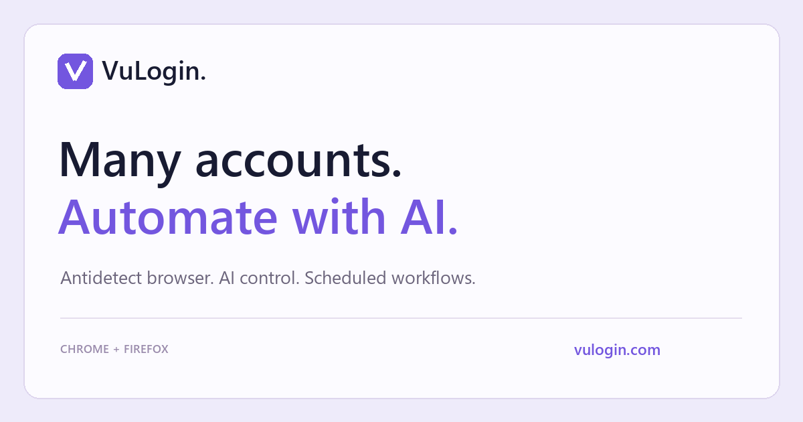
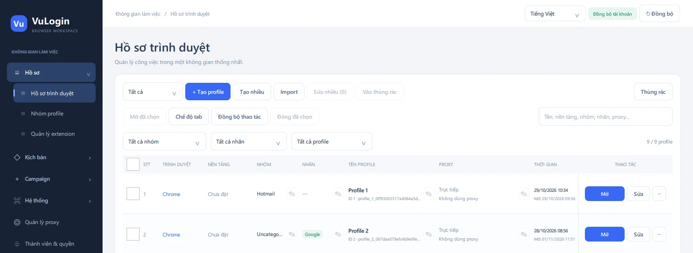
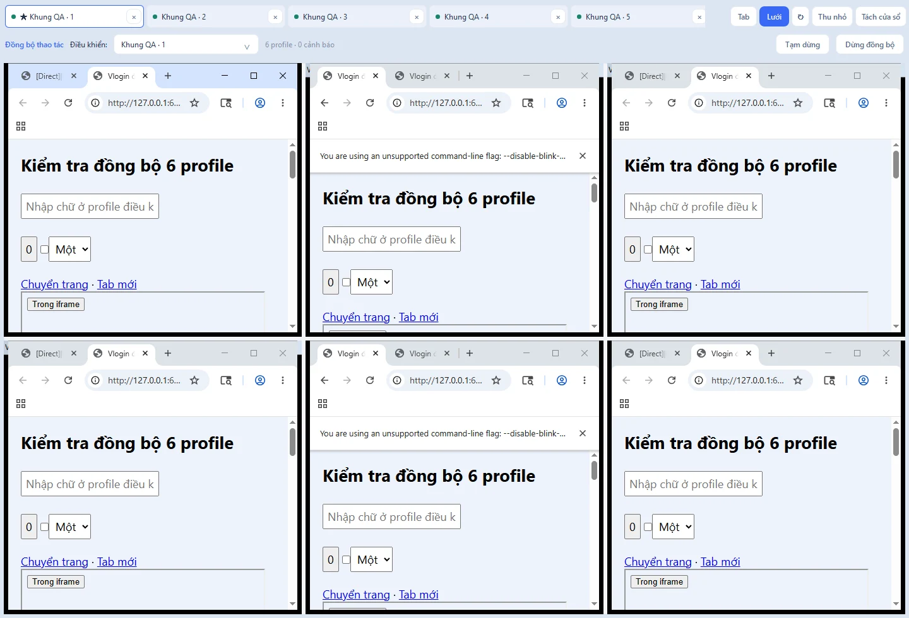
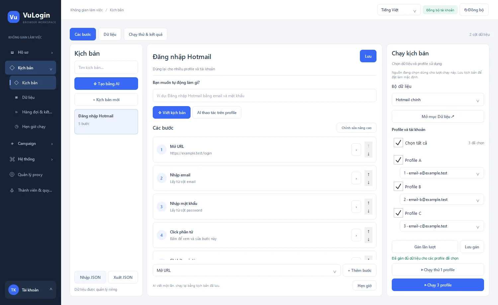
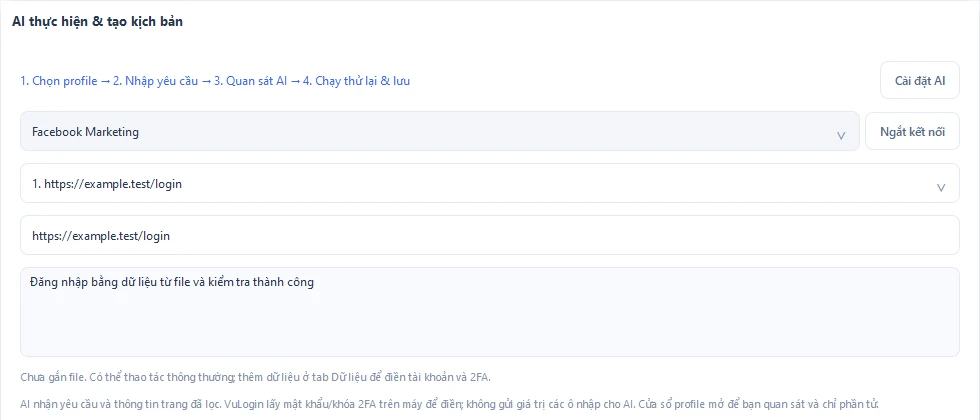
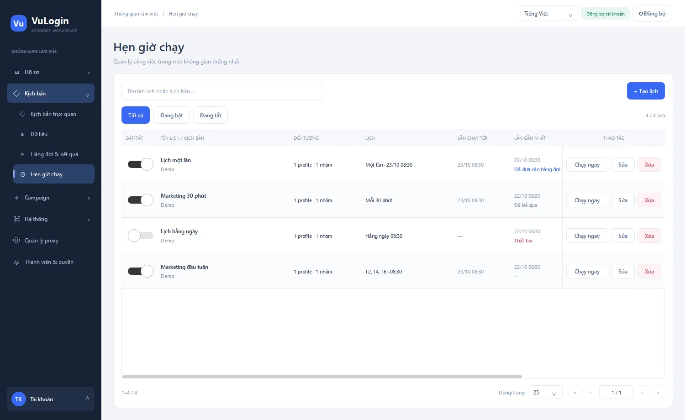
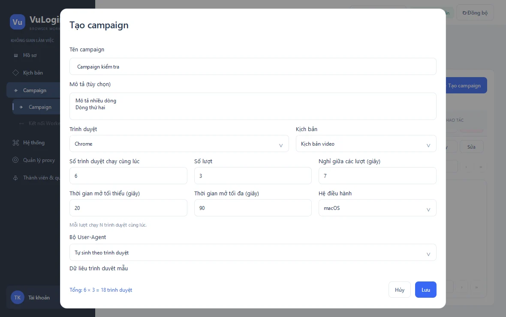
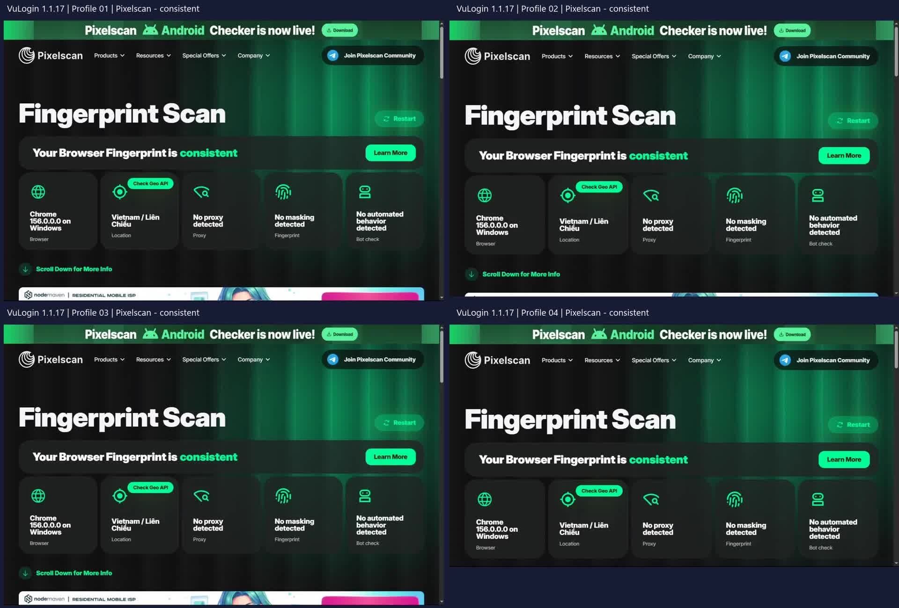

<div align="center">



# VuLogin

**Trình duyệt Antidetect đa tài khoản & Tự động hóa bằng AI**

Chạy nhiều tài khoản trong các profile trình duyệt riêng biệt, để AI xử lý tác vụ trên trình duyệt, lên lịch kịch bản và chạy chiến dịch với profile tạm thời mới cho mỗi lượt.

### 🆓 Miễn phí mãi mãi — không giới hạn profile, gói Free không giới hạn thời gian sử dụng

[🌐 Website](https://vulogin.com/vi/) · [⬇️ Tải về](https://vulogin.com/download/) · [📖 Tài liệu](https://vulogin.com/docs/) · [🔌 API](https://vulogin.com/api/) · [💲 Bảng giá](https://vulogin.com/plans/) · [🖥️ Panel](https://panel.vulogin.com)

[🇬🇧 English](README.md) · [💬 Discord](https://discord.gg/QprX6zekYf) · [✈️ Telegram](https://t.me/vulogin)

</div>

---

> **Về repository này**
> Đây là repo công khai dùng để giới thiệu và hướng dẫn sử dụng VuLogin, không chứa mã nguồn. Phần mềm, bản tải chính thức, tài liệu và quản lý tài khoản đều nằm tại **[vulogin.com](https://vulogin.com/vi/)**.

## Mục lục

- [VuLogin là gì?](#vulogin-là-gì)
- [Tính năng chính](#tính-năng-chính)
- [Hình ảnh giao diện](#hình-ảnh-giao-diện)
- [Bắt đầu nhanh](#bắt-đầu-nhanh)
- [Hướng dẫn sử dụng](#hướng-dẫn-sử-dụng)
- [Bảng giá](#bảng-giá)
- [Câu hỏi thường gặp](#câu-hỏi-thường-gặp)
- [Cộng đồng & hỗ trợ](#cộng-đồng--hỗ-trợ)
- [Sử dụng có trách nhiệm](#sử-dụng-có-trách-nhiệm)

## VuLogin là gì?

VuLogin là không gian làm việc trình duyệt antidetect trên máy tính. Phần mềm quản lý các profile trình duyệt tách biệt, mỗi profile có phiên đăng nhập, cookie, bộ nhớ và danh tính trình duyệt cấu hình riêng, kết hợp với proxy, phân quyền nhóm và tự động hóa trong cùng một nơi.

Phù hợp với người quản lý nhiều tài khoản được phép sử dụng trên **mạng xã hội, thương mại điện tử, quảng cáo và các nền tảng web khác**, muốn giảm bớt công việc thủ công lặp lại.

- 🖥️ **Nền tảng:** Windows 64-bit (bộ cài EXE). Bản macOS sẽ ra mắt sau.
- 🌍 **Engine:** profile Chrome và Firefox.
- 🆓 **Miễn phí mãi mãi** — gói Free giá 0$, **không giới hạn số profile** và không giới hạn thời gian sử dụng. Chỉ nâng cấp khi cần thêm thiết bị, phiên, workers hoặc thành viên. Xem [Bảng giá](#bảng-giá).

## Tính năng chính

| | Tính năng | Mô tả |
|---|---|---|
| 👥 | **Nhiều tài khoản, nhiều nền tảng** | Mỗi profile lưu riêng phiên đăng nhập, cookie và bộ nhớ trình duyệt, giữ các tài khoản tách biệt. |
| 🛡️ | **Danh tính trình duyệt & quyền riêng tư** | Mỗi profile có danh tính riêng, cấu hình ngôn ngữ, múi giờ, proxy để giảm nguy cơ liên kết tài khoản qua dấu vân tay trình duyệt. |
| 🤖 | **AI điều khiển trình duyệt** | Mô tả tác vụ bằng ngôn ngữ thường ngày. AI quan sát tab đã chọn, có thể điều hướng, nhấp chuột, nhập dữ liệu trên profile thật; bạn theo dõi và dừng bất cứ lúc nào. |
| 🎬 | **Kịch bản trực quan** | Ghi lại thao tác, chỉnh sửa các bước trên canvas, gán dataset cho profile và lưu để chạy lại. |
| ⏰ | **Lên lịch tự động** | Đặt lịch chạy kịch bản đã lưu trên các profile đã chọn; kết quả hiển thị trong hàng đợi. |
| 🔁 | **Chiến dịch profile mới** | Chạy kịch bản theo lô profile tạm thời. Mỗi trình duyệt có danh tính mới và được dọn dẹp sau khi chạy. Tùy chỉnh số luồng, số lần chạy và thời gian nghỉ. |
| 🌐 | **Quản lý proxy** | Kiểm tra kết nối, tổ chức thư viện proxy và gán cho profile. Chiến dịch có thể xoay vòng proxy đã chọn. |
| 🧑‍🤝‍🧑 | **Làm việc nhóm** | Nhóm profile theo thương hiệu, khách hàng hoặc nền tảng và phân quyền thành viên. |
| 🔌 | **Local API** | Liệt kê, mở, đóng profile, chạy kịch bản và xem job từ script của bạn (Python, Playwright, Selenium, REST/JSON). |
| 📱 | **Điện thoại Android** | Thêm điện thoại qua USB hoặc Wi-Fi và mở màn hình ngay trong VuLogin cho Windows. |
| ☁️ | **Cloud Backup tùy chọn** | Sao lưu dữ liệu phiên theo từng profile khi cần. |

## Hình ảnh giao diện

Hình ảnh từ website chính thức; các màn hình tính năng dùng dữ liệu demo.

### Không gian làm việc đa tài khoản



*Quản lý profile, nhóm tài khoản, thẻ và proxy trong một giao diện.*

### Chế độ lưới trình duyệt



*Sáu cửa sổ trình duyệt thật được xếp lưới trong VuLogin (dữ liệu thử nghiệm).*

### Kịch bản tự động hóa tái sử dụng



*Trình chỉnh sửa kịch bản với các bước theo thứ tự và dataset gán cho nhiều profile.*

### AI điều khiển trình duyệt



*Chọn profile và tab mục tiêu, rồi mô tả tác vụ bằng ngôn ngữ tự nhiên.*

### Lên lịch kịch bản



*Chọn profile và đặt lịch chạy kịch bản ngay trong ứng dụng.*

### Chiến dịch với profile mới



*Cấu hình chạy lặp lại với profile tạm mới cho mỗi trình duyệt.*

### Pixelscan: bốn profile nhất quán



*Chụp ngày 01/11/2026 trên VuLogin 1.1.17, kết nối trực tiếp. Kết quả chỉ áp dụng cho cấu hình thử nghiệm này, không đảm bảo cho mọi website.*

## Bắt đầu nhanh

1. **Mở tài khoản** tại [panel.vulogin.com](https://panel.vulogin.com), đăng nhập hoặc đăng ký.
2. **Tải ứng dụng** tại [vulogin.com/download](https://vulogin.com/download/) và chạy bộ cài EXE cho Windows.
3. **Đăng nhập** ứng dụng bằng tài khoản VuLogin và cài runtime trình duyệt mà ứng dụng yêu cầu.
4. **Tạo profile** (Chrome hoặc Firefox), thiết lập danh tính và proxy, rồi mở profile và truy cập các trang bạn được phép sử dụng.
5. **Tự động hóa**: để AI thao tác, lưu thành kịch bản, sau đó lên lịch hoặc chạy chiến dịch.

Hướng dẫn đầy đủ: [Getting started](https://vulogin.com/docs/getting-started/)

## Hướng dẫn sử dụng

### 1. Tạo profile trình duyệt

Trong **Browser profiles**, chọn **Chrome** hoặc **Firefox** rồi tạo profile. Đặt tên, nhóm, thẻ và ghi chú.

- Chọn engine ngay khi tạo; profile đã tạo không đổi được giữa Chrome và Firefox.
- Mỗi profile có thư mục dữ liệu, cookie và bộ nhớ riêng.
- Mở lại đúng profile để giữ nguyên ngữ cảnh trình duyệt.
- Tránh mở cùng một profile trên nhiều máy cùng lúc, trừ khi quy trình của bạn hỗ trợ.

### 2. Thiết lập danh tính và proxy

- Cấu hình các tùy chọn fingerprint được hỗ trợ, ngôn ngữ và múi giờ.
- Thêm proxy (giao thức, host, port, thông tin đăng nhập) vào thư viện, kiểm tra rồi gán cho profile. VuLogin quản lý proxy; bạn cần tự mua proxy từ nhà cung cấp.
- Dùng tính năng tra cứu proxy để đồng bộ ngôn ngữ và múi giờ với kết nối.
- Hãy đóng profile trước khi thay đổi cài đặt danh tính.
- Firefox hỗ trợ HTTP, HTTPS và SOCKS5 không xác thực; hãy kiểm tra tổ hợp được hỗ trợ trong phiên bản bạn cài.

Hướng dẫn đầy đủ: [Profiles & proxies](https://vulogin.com/docs/proxies/)

### 3. AI điều khiển trình duyệt

1. Vào **Scenarios → AI browser control**.
2. Kết nối dịch vụ AI bạn chọn (cần thiết lập AI trước).
3. Chọn profile và tab mục tiêu.
4. Mô tả tác vụ bằng ngôn ngữ tự nhiên, theo dõi tiến trình và dừng khi cần.

### 4. Kịch bản, lịch chạy và chiến dịch

- **Lưu thao tác lặp lại:** xem lại các bước AI đã ghi (hoặc tự ghi), rồi lưu thành kịch bản trong trình chỉnh sửa trực quan. Hãy chạy thử trước khi dùng lại.
- **Dataset:** gán từng dòng dữ liệu cho profile để mỗi tài khoản dùng đúng giá trị. TOTP là tùy chọn.
- **Lịch chạy:** chọn kịch bản đã lưu và các profile rồi đặt thời gian. Bộ lập lịch hoạt động khi ứng dụng VuLogin hoặc dịch vụ Local API đang chạy; không phải job chạy nền trên máy chủ.
- **Chiến dịch:** chọn kịch bản, đặt số trình duyệt chạy cùng lúc, số lô và thời gian nghỉ giữa các lô. Ở chế độ danh tính mới, mỗi trình duyệt tạm có profile mới và được dọn dẹp sau đó. Phiên đăng nhập không được giữ giữa các lượt chạy.
- **Xem kết quả:** kiểm tra thành công, thất bại, lỗi của từng lượt, rồi tinh chỉnh số luồng và thời gian.

Hướng dẫn đầy đủ: [AI, schedules & campaigns](https://vulogin.com/docs/automation/)

### 5. Kết nối điện thoại Android

1. Trong VuLogin cho Windows, mở **Phones → Android**, bấm **Install Android tools** nếu được yêu cầu.
2. Trên điện thoại bật **Developer options** (chạm 7 lần vào *Build number*) và bật **USB debugging**, hoặc **Wireless debugging** trên Android 11+.
3. Kết nối bằng cáp USB, hoặc dùng **Pair over Wi-Fi** với IP:port ghép nối và mã 6 số.
4. Bấm **Open screen** (hoặc **Open selected** để mở nhiều máy) và **Tile windows** để sắp xếp cửa sổ.

Hướng dẫn đầy đủ: [Connect Android phones](https://vulogin.com/docs/android/)

### 6. Local API

Bật dịch vụ trong ứng dụng (**Local API**), sao chép key và gọi endpoint nội bộ (mặc định `http://127.0.0.1:53201/api/v2`):

```bash
curl --request POST \
  'http://127.0.0.1:53201/api/v2/profile-list' \
  --header "Authorization: Bearer $VULOGIN_API_KEY" \
  --header 'Content-Type: application/json' \
  --data '{"page": 1, "limit": 10}'
```

Endpoint chính: `profile-list`, `profile-info`, `profile-create`, `profile-update`, `profile-delete`, `profile-open`, `profile-close`, `profile-opened-list`, `group-*`, `scenario-list`, `scenario-run`, `schedule-list`, `schedule-run`, `queue-list`, `queue-start`, `queue-pause`, `queue-cancel`.

Lưu ý: chỉ chạy trên máy của bạn (không mở port ra Internet); tối đa 3 request POST đồng thời; Playwright/Selenium qua CDP dùng cho profile Chrome.

Tài liệu đầy đủ: [Local API v2](https://vulogin.com/api/)

## Bảng giá

🆓 **Gói Free miễn phí mãi mãi** — dùng bao lâu tùy ý, không hết hạn và **không giới hạn số lượng profile**. Các gói trả phí chỉ nâng giới hạn thành viên, thiết bị, phiên đồng thời và workers bên dưới.

Giá tham khảo (USD/tháng). Gói dài hạn được giảm giá: 3 tháng −10%, 6 tháng −20%, 12 tháng −30%, thanh toán trước.

| Gói | Từ / tháng | Thành viên | Thiết bị | Phiên đồng thời | Workers |
|---|---|---|---|---|---|
| **Free** | $0 | 1 | 1 | 1 | 0 |
| **Personal** | $2.99 | 1 | 2 | 1 | 0 |
| **Pro** ⭐ | $7.99 | 2 | 3 | 2 | 3 |
| **Team** | $17.99 | 10 | 15 | 10 | 10 |
| **Agency** | $39.99 | 30 | 50 | 30 | 30 |

Mọi gói đều gồm profile, proxy & extension, kịch bản tự động trực quan, chiến dịch profile mới và phân quyền nhóm. Số thành viên đã tính cả chủ workspace; workers dùng để chạy job tự động. Giá chỉ mang tính tham khảo — vui lòng xác nhận giá và phương thức thanh toán khi thanh toán: **[vulogin.com/plans](https://vulogin.com/plans/)**.

## Câu hỏi thường gặp

**Trình duyệt antidetect là gì?**
Là trình duyệt quản lý các profile tách biệt và các tín hiệu danh tính trình duyệt có thể cấu hình. VuLogin kết hợp chúng với proxy, phân quyền nhóm và tự động hóa.

**Hỗ trợ Chrome và Firefox không?**
Có, chọn engine khi tạo profile. Tích hợp CDP/Playwright/Selenium dành cho Chrome; extension Chrome Web Store chỉ áp dụng cho Chrome.

**VuLogin có kèm proxy không?**
Không. Bạn tự mua dịch vụ proxy và gán vào profile.

**AI có thực sự điều khiển được trình duyệt không?**
Có, sau khi thiết lập AI. AI làm việc trên profile và tab bạn chọn; bạn có thể xem lại các thao tác đã ghi và dừng bất cứ lúc nào.

**Mỗi lượt chiến dịch có dùng profile khác không?**
Có, chiến dịch dùng profile tạm với danh tính mới cho mỗi trình duyệt và được dọn dẹp sau khi chạy.

**Profile riêng có đảm bảo tài khoản không bao giờ bị gắn cờ không?**
Không. Kết quả phụ thuộc vào website, proxy, cấu hình trình duyệt và hoạt động của tài khoản.

**Có bản macOS không?**
Chưa — bản macOS riêng sẽ ra mắt sau.

Cần hỗ trợ? [Liên hệ](https://vulogin.com/contact/)

## Cộng đồng & hỗ trợ

- 🌐 Website: [vulogin.com](https://vulogin.com/vi/)
- 🖥️ Panel: [panel.vulogin.com](https://panel.vulogin.com)
- 💬 Discord: [discord.gg/QprX6zekYf](https://discord.gg/QprX6zekYf)
- ✈️ Telegram: [t.me/vulogin](https://t.me/vulogin)
- ✉️ Liên hệ: [vulogin.com/contact](https://vulogin.com/contact/)
- 📰 Blog: [vulogin.com/blog](https://vulogin.com/blog/)
- Pháp lý: [Điều khoản](https://vulogin.com/terms/) · [Quyền riêng tư](https://vulogin.com/privacy/) · [Sử dụng chấp nhận được](https://vulogin.com/acceptable-use/)

## Sử dụng có trách nhiệm

VuLogin dành cho công việc bạn được phép thực hiện. Chỉ dùng với tài khoản bạn sở hữu hoặc được phép quản lý, đồng thời tuân thủ điều khoản của từng nền tảng và [chính sách sử dụng chấp nhận được](https://vulogin.com/acceptable-use/) của VuLogin.

---

<div align="center">

© 2026 VuLogin. Bảo lưu mọi quyền. · **[Bắt đầu tại vulogin.com →](https://vulogin.com/vi/)**

</div>
